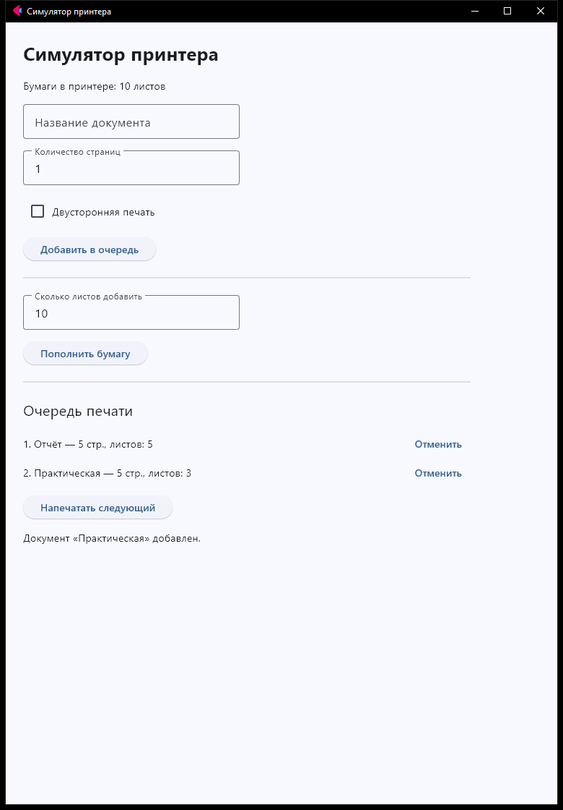
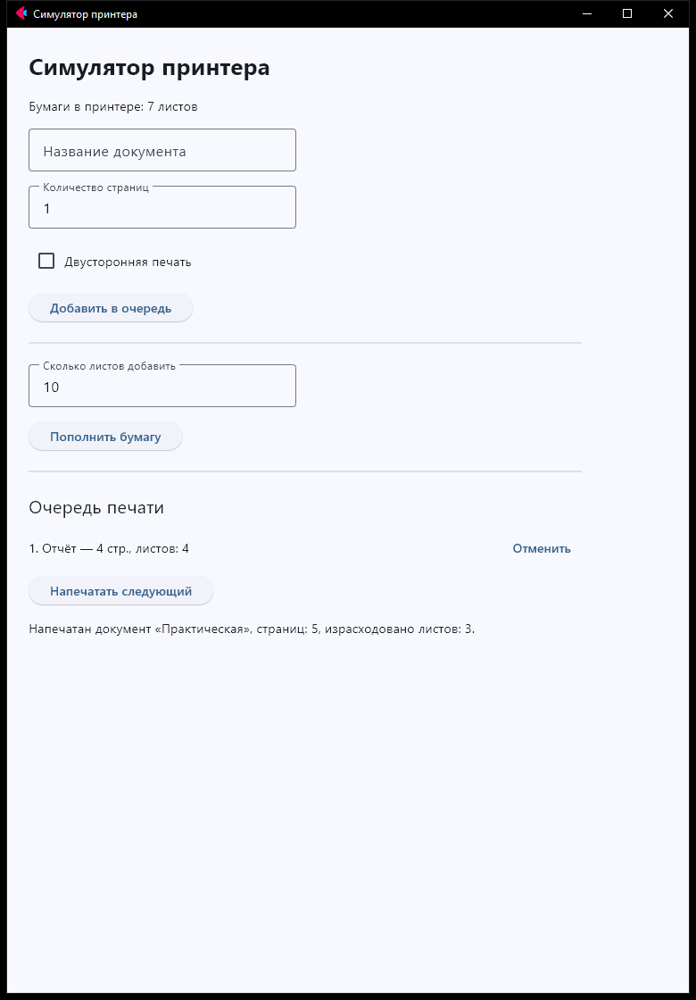

# Симулятор принтера

Проект по ООП на Python, окно сделано через Flet

Можно добавлять документы в очередь, печатать и отменять их
Есть двусторонняя печать и пополнение бумаги
Сначала есть 10 листов, если их не хватает, документ остается в очереди

Для запуска нужно установить библиотеки и запустить main.py

```
python -m pip install -r requirements.txt
python main.py
```

main.py отвечает за окно, а printer.py за документы и сам принтер

Скрины работы

Очередь



Если мало бумаги


После печати


